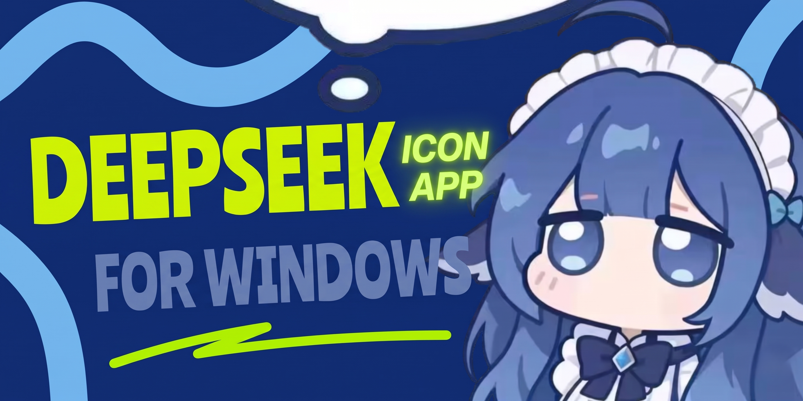

<div align="right">
  🌐 <strong>English</strong> | <a href="README_vi.md">Tiếng Việt</a>
</div>

# 🐋 DeepSeek-Pet (DeepSeek Anime Chibi Overlay)




A lightweight, borderless, transparent desktop overlay companion featuring the adorable **DeepSeek anime chibi mascot**! 

She stays elegantly on your desktop with zero obstructive window borders, provides click-through for transparent screen areas, tracks your DeepSeek API token balance, and lets you chat in real-time with an intelligent AI personality.

---

## ✨ Features

- **🖥️ True Desktop Overlay**: Rendered with a transparent canvas without window borders, title bars, or browser chrome. Only the chibi character, speech bubbles, and sleek menus float naturally over your desktop.
- **💬 Live AI Chat via Google Gemini**: Click the speech bubble at any time to open a borderless chat input. DeepSeek replies concisely, warmly, and cleverly with cute expressions and emoji (no robotic or tsundere attitude).
- **🌐 One-Click Bilingual Language Switcher**: Easily switch between **English 🇺🇸** and **Tiếng Việt 🇻🇳** directly inside the settings menu. Everything—from menus, thoughts, chat placeholders, and the entire Usage Records panel—updates instantly in real-time.
- **📊 Usage Records & Real Balance Tracking**: Built-in usage accounting sub-panel to monitor token consumption, 7-day expense history, and local model estimates. Enter your DeepSeek API key to observe live token balance in the speech bubble.
- **🖱️ Smart Mouse Click-Through**: Transparent areas automatically pass mouse clicks directly to background windows and applications without interrupting your workflow.
- **🖐️ Draggable & Edge Docking**: Drag the chibi anywhere across your screens; she automatically snaps and mirrors at screen boundaries and preserves her location across restarts.
- **📐 Full Screen Mode vs Compact Hitbox**: Switch between a full-screen transparent canvas and a compact window hitbox directly from the menu or tray options (prevents screen capture/snip tools from selecting the entire monitor).
- **⚙️ Windows System Tray Companion**: Minimize, restore, reset position to the bottom-right corner, toggle startup with Windows, or exit safely from the Windows notification area.
- **🎵 Sound Effects & Animations**: Head-patting interaction (`rua.gif`), audio feedback, and customizable random thoughts.

---

## 🎮 Interactive Controls

| Action | Result |
| :--- | :--- |
| **Click 1 on Chibi** | Random thought bubble from DeepSeek (in current language). |
| **Click 2 on Chibi** | Check DeepSeek token & balance status. |
| **Click 3 on Chibi** | Dismiss bubble. |
| **Click Speech Bubble** | Open text input box to chat live with DeepSeek. |
| **Press Enter / Click Reply** | Send message to AI; DeepSeek replies within 1–2 short sentences. Reply auto-closes after 10 seconds or upon clicking it. |
| **Right-Click Chibi / Hamburger Icon** | Open widget settings menu. |
| **Click Language Button** | Toggle between `🇻🇳 Tiếng Việt` and `🇺🇸 English`. |

---

## 📥 Installation & How to Run

1. Download the latest release `.zip` from the [Releases](../../releases) tab.
2. Extract the archive into a folder of your choice.
3. Launch the application:
   - **Method 1 (Recommended):** Double-click `DeepSeekWhaleWidget.exe`.
   - **Method 2:** Double-click `run-overlay.bat`.
   - **Method 3:** Run `npm start` in PowerShell / terminal (requires Node.js).

---

## 🔑 API Keys Configuration

### 1. Google Gemini API Key (for Live AI Chat)
1. Right-click the chibi or click the menu button to open Settings.
2. In the **Google Gemini API Key** card at the top, paste your key from [Google AI Studio](https://aistudio.google.com/) (`AIza...`).
3. Click **Save**. The badge will show `✓ Connected`.
4. Click on DeepSeek's speech bubble and start chatting!

### 2. DeepSeek API Key (for Token Balance Check)
1. Open the menu and click **- = Usage Records = -**.
2. Under **DeepSeek API Key (Token Check)**, paste your DeepSeek API key (`sk-...`).
3. Click **Save**. DeepSeek will verify the key and display your balance and remaining tokens in the bubble on Click 2.

---

## 🛠️ Build from Source

To compile the C# launcher executable or run in developer mode:

```powershell
# Rebuild DeepSeekWhaleWidget.exe
powershell -ExecutionPolicy Bypass -File .\build.ps1

# Run development overlay
npm start
```

---

## 📄 License & Credits

- MIT License.
- Ported and enhanced from `dsh-whale-widget`.
